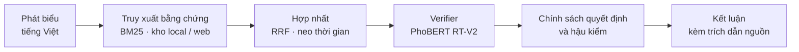

# Vietnamese Fact-Checking

**Hệ thống kiểm chứng thông tin tiếng Việt dựa trên truy xuất bằng chứng.**

Nhận một phát biểu tiếng Việt, tự tìm bằng chứng trong kho bài báo (và trên web nếu cần), rồi kết luận **SUPPORTED**, **REFUTED** hoặc **NOT_ENOUGH_INFO**, kèm đoạn văn được trích dẫn và đường dẫn tới nguồn để người dùng tự kiểm tra lại.



## Điểm nổi bật

- **Truy xuất rồi suy luận (retrieval → verification).** BM25 trên kho 5.845 đoạn báo, có thể mở rộng sang web qua 33 nguồn được duyệt trước.
- **Verifier PhoBERT RT-V2.** PhoBERT-base tinh chỉnh trên ViFactCheck, sau đó huấn luyện tiếp trên bằng chứng do hệ thống truy xuất thật.
- **Ba cải tiến có kiểm định thống kê.** Ensemble cách dựng bằng chứng, luật cặp-tối-thiểu bắt các câu "gần trùng nguồn nhưng sai một chi tiết", và neo thời gian cho phát biểu thời sự.
- **Luôn trích dẫn nguồn.** Mỗi kết luận đi kèm đoạn bằng chứng và URL gốc.
- **Có giao diện.** Giao diện Gradio (khuyên dùng) và Streamlit, kèm công cụ dòng lệnh.

## Kết quả

Đánh giá trên bộ dữ liệu chuẩn ViFactCheck (tập test 1.076 phát biểu), theo Macro-F1.

| Cấu hình | Macro-F1 | Ghi chú |
|---|---:|---|
| Verifier oracle (E2, bằng chứng vàng) | 81,07% | Trần của bộ phân loại, không phải năng lực hệ thống |
| Đầu-cuối, baseline W4-02 | 59,49% | BM25 → E2 |
| Đầu-cuối, rerank W4-05 | 69,92% | E2 + rerank theo metadata |
| **Đầu-cuối, cấu hình cuối** | **72,31%** | RT-V2 + ensemble + cặp-tối-thiểu; **+12,8 điểm** so với W4-02 (KTC 95%: +10,0 đến +15,6) |

Mọi lựa chọn cấu hình được quyết định trên tập dev có nhãn người. Tập test đã được dùng ở các lượt trước, nên đây là **so sánh tương đối, không phải bằng chứng độc lập**. Phân tích lỗi cho thấy phần mất mát chủ yếu nằm ở bước suy luận, không phải bước truy xuất.

> **Giới hạn hiện tại.** Hệ thống là bản thử nghiệm và **chưa được xác nhận đạt 80% ngoài thực tế**. Chế độ local + web chưa có tập phát biểu thời sự có nhãn để đo định lượng. Xem [báo cáo tổng kết](docs/BAO_CAO_TONG_KET.md) và [kết quả & giới hạn](docs/BAO_CAO_KET_QUA_GIOI_HAN.md).

## Cài đặt

Yêu cầu: Python 3.13, Java (cho VnCoreNLP).

```powershell
python -m venv .venv
.\.venv\Scripts\Activate.ps1
pip install -r requirements.txt
```

Ngoài thư viện, cần chuẩn bị:

- Checkpoint verifier tại `models/rt_v2_balanced/best_model` (RT-V2).
- VnCoreNLP tại `models/vncorenlp`.

Kiểm tra môi trường (thư viện, model, Java, hash dữ liệu):

```powershell
py -3.13 scripts/check_release.py
```

Hướng dẫn chi tiết: [tái lập kết quả](docs/REPRODUCIBILITY_BASELINE.md). Nếu Windows Application Control chặn PyTorch, giao diện tự chuyển sang chế độ demo dựa trên luật và báo rõ cho người dùng.

## Sử dụng

### Giao diện web

```powershell
py -3.13 app_gradio.py                  # Gradio (khuyên dùng) → http://127.0.0.1:7860
py -3.13 -m streamlit run app.py        # Streamlit (bản cũ, cùng kết quả)
```

Giao diện có hai chế độ:

| Chế độ | Bằng chứng | Khi nào dùng | Đã đo |
|---|---|---|---|
| **Kho local** | BM25 trên 5.845 đoạn ViFactCheck | Báo cáo, so sánh, demo | Có, Macro-F1 **72,3%** |
| **Local + web** | Thêm Tavily qua 33 nguồn allowlist, neo thời gian, gộp URL, guard | Phát biểu thời sự ("hôm nay", "hiện nay") | Chưa |

Chế độ web cần `TAVILY_API_KEY` trong `.env` (xem `.env.example`). Thiếu key thì hệ thống tự chạy chỉ với kho local.

### Dòng lệnh

```powershell
# Kiểm chứng một phát biểu (local + web)
py -3.13 scripts/run_web_fact_check.py --claim "Giá xăng tăng từ chiều nay"

# Chỉ dùng kho local
py -3.13 scripts/run_web_fact_check.py --claim "..." --local-only

# Chạy 6 ca demo có kỳ vọng → outputs/demo/demo_cases.md
py -3.13 scripts/run_demo_cases.py [--with-web]

# Bảng so sánh các cấu hình kèm khoảng tin cậy (không chạy lại model)
py -3.13 scripts/compare_final_vs_baselines.py

# Bộ kiểm thử (~300 test, không cần GPU)
py -3.13 -m pytest -q --basetemp=.pytest_tmp
```

### So sánh PhoBERT với LLM trên 84 gold case

Đặt `GEMINI_API_KEY` và `GEMINI_MODEL` trong `.env`, chạy từng mô hình bằng `scripts/run_model_gold.py`, rồi chấm điểm bằng `scripts/evaluate_model_gold.py`:

```powershell
py -3.13 scripts/run_model_gold.py --backend phobert --output <file.jsonl>
py -3.13 scripts/run_model_gold.py --backend gemini  --output <file.jsonl>
```

Hai nhánh nhận cùng bằng chứng cố định, không truy xuất lại và không đọc đáp án khi suy luận. Gemini chỉ dùng cho bộ so sánh, chưa được nối vào nút kiểm chứng của giao diện. Xem [hướng dẫn chi tiết](docs/HUONG_DAN_GEMINI_COMPARISON.md).

## Dữ liệu

Dữ liệu ViFactCheck dùng để tái lập được lưu trong repo: dữ liệu gốc ở `data/raw/`, dữ liệu đã xử lý ở `data/processed/`, kho bằng chứng ở `data/evidence/`. Mỗi đoạn trong kho có cấu trúc:

```json
{"document_id": "...", "passage_id": "...", "content": "...", "source": "...", "url": "..."}
```

Để dựng lại kho bằng chứng từ ba split ViFactCheck (định dạng Hugging Face Arrow hoặc Parquet) đặt trong `data/raw/vifactcheck/`:

```powershell
python scripts/build_vifactcheck_evidence.py
```

Script đọc `Context`, `Author`, `Url`, khử trùng theo URL, rồi chia bài báo thành các đoạn tối đa 700 ký tự.

## Cấu trúc thư mục

```text
├── src/                    Pipeline và các thành phần NLP
├── scripts/                Công cụ chạy, đánh giá, dựng dữ liệu
├── configs/config.yaml     Cấu hình tập trung
├── data/                   Dữ liệu gốc, đã xử lý, kho bằng chứng
├── models/                 Checkpoint verifier, VnCoreNLP
├── tests/                  Kiểm thử tự động
├── docs/                   Báo cáo, hướng dẫn, quy trình nghiên cứu
├── outputs/                Metrics, hình, dự đoán (không đưa artefact lớn lên Git)
├── app_gradio.py           Giao diện Gradio
└── app.py                  Giao diện Streamlit
```

Các thành phần truy xuất chính: web retriever theo allowlist (`src/web_retriever.py`), fusion RRF local + web (`src/fusion_retriever.py`), neo thời gian (`src/temporal_gate.py`), gộp URL (`src/topical_rerank.py`). Tất cả được dựng chung tại `src/system_builder.py` cho cả giao diện lẫn dòng lệnh.

## Tài liệu

| Tài liệu | Nội dung |
|---|---|
| [Giới thiệu dự án](docs/GIOI_THIEU_DU_AN.md) | Tổng quan dành cho người mới |
| [Báo cáo tổng kết](docs/BAO_CAO_TONG_KET.md) | Kết quả và kết luận chính |
| [Kết quả và giới hạn](docs/BAO_CAO_KET_QUA_GIOI_HAN.md) | Phạm vi đo và các giới hạn đã biết |
| [Lỗi và challenge set](docs/BAO_CAO_LOI_TU_TEST_DOI_KHANG.md) | Bộ kiểm thử đối kháng và phân tích lỗi |
| [Kế hoạch phạm vi đầy đủ](docs/KE_HOACH_DAY_DU_DE_TAI.md) | Kế hoạch 6 tuần |
| [Ma trận yêu cầu](docs/MA_TRAN_YEU_CAU_DE_TAI.md) | Liên kết yêu cầu với task và thí nghiệm |
| [Hướng dẫn test web end-to-end](docs/HUONG_DAN_TEST_WEB_END_TO_END.md) | Kiểm thử nhánh web |
| [Việc còn lại](docs/HUONG_DAN_VIEC_CON_LAI.md) | Hạng mục cần người hoặc GPU |

## Báo cáo bài tập lớn

Dự án là bài tập lớn môn **Xử lý ngôn ngữ tự nhiên** (Khoa Công nghệ thông tin, Trường Đại học Giao thông Vận tải, lớp N05), giảng viên hướng dẫn **Nguyễn Quang Trung**.

- Báo cáo: [`docs/BAO_CAO_DE_TAI_XLNNTN_chuan_v3.docx`](docs/BAO_CAO_DE_TAI_XLNNTN_chuan_v3.docx)
- Slide: [pptx](docs/SLIDE_BAO_CAO_DE_TAI.pptx) · [pdf](docs/SLIDE_BAO_CAO_DE_TAI.pdf)

Báo cáo gồm 6 chương: giới thiệu bài toán; tổng quan nghiên cứu; kiến thức nền tảng; giải pháp đề xuất; thực nghiệm và kết quả; kết luận và hướng phát triển.

## Nhóm thực hiện

| Thành viên | MSSV | Phụ trách |
|---|---|---|
| Mai Đức Vinh | 221231051 | Dữ liệu, mô hình, đánh giá |
| Trịnh Mạnh Quang | 221230965 | Truy xuất, pipeline, giao diện |

## Tham khảo

Dữ liệu và phương pháp dựa trên [ViFactCheck](https://arxiv.org/abs/2412.15308) (AAAI 2025); mô hình ngôn ngữ [PhoBERT](https://aclanthology.org/2020.findings-emnlp.92) và công cụ tách từ VnCoreNLP. Danh sách tài liệu tham khảo đầy đủ nằm trong báo cáo.
